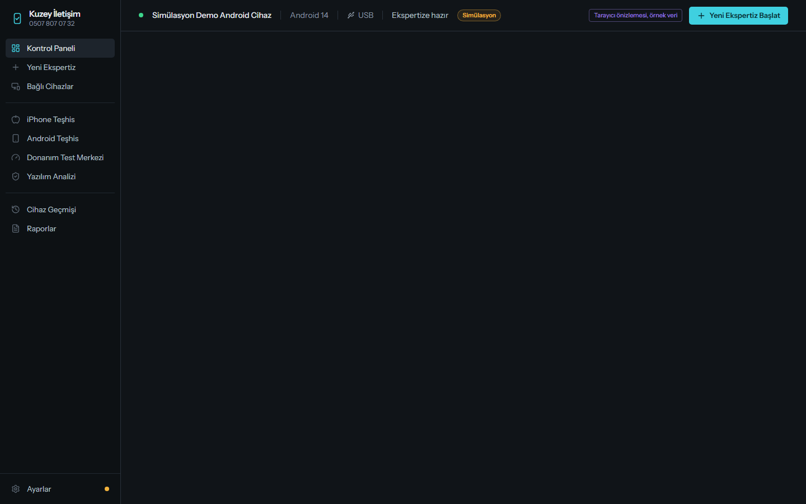
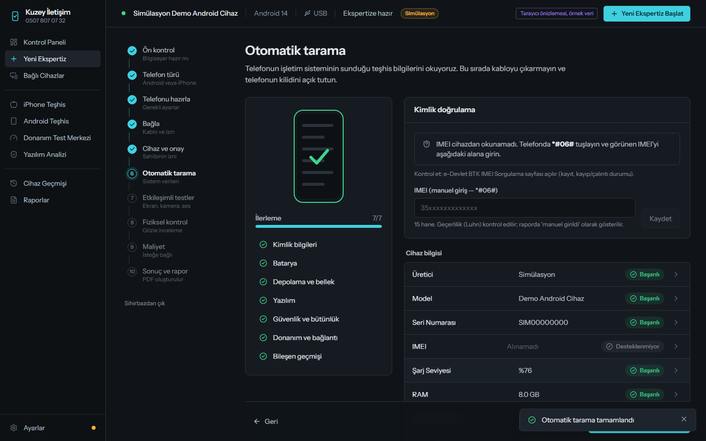
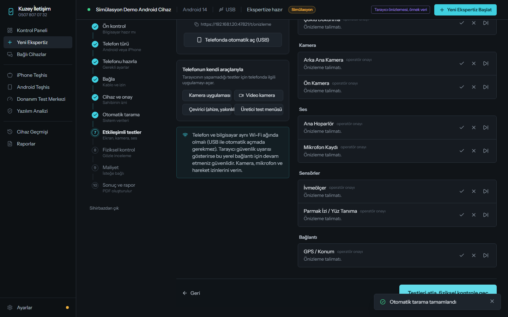
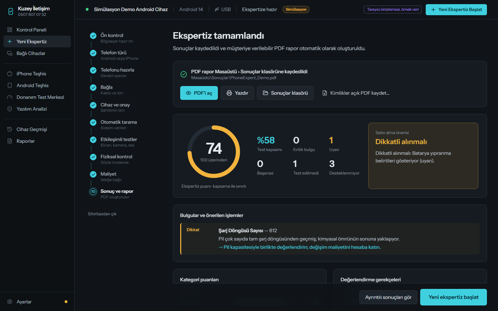
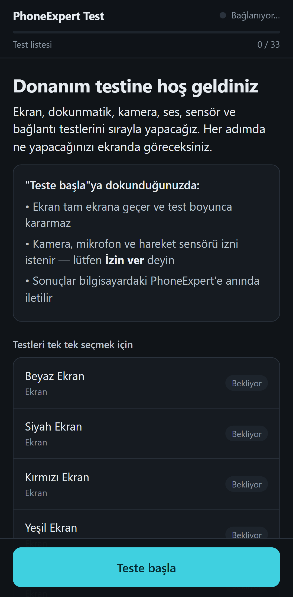
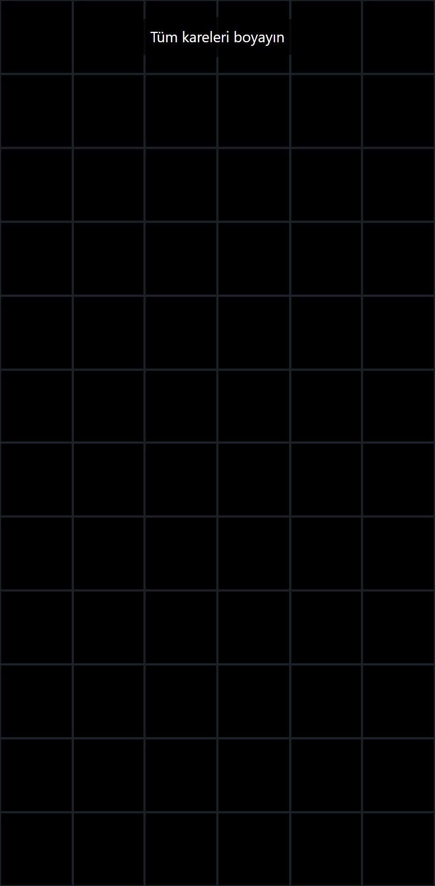
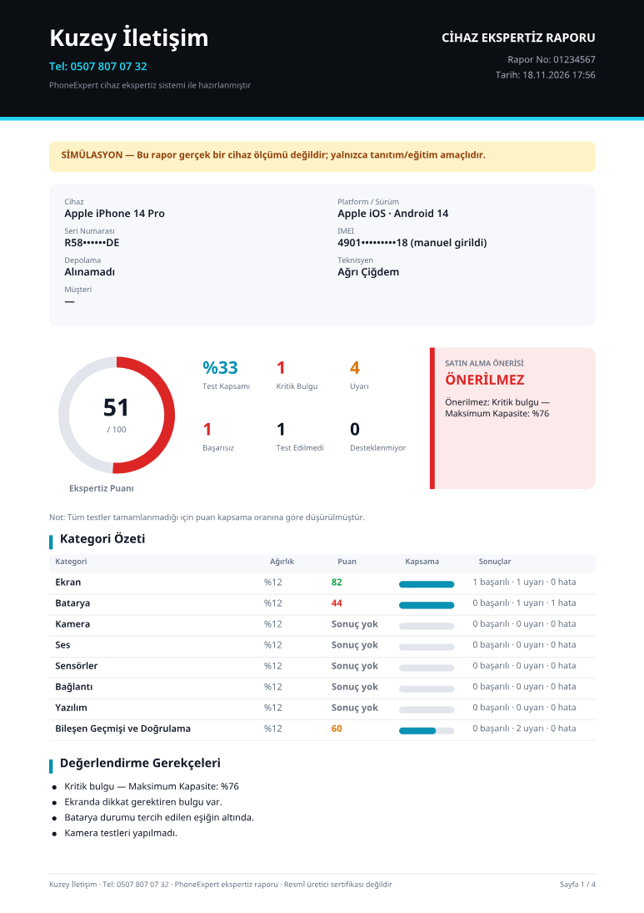
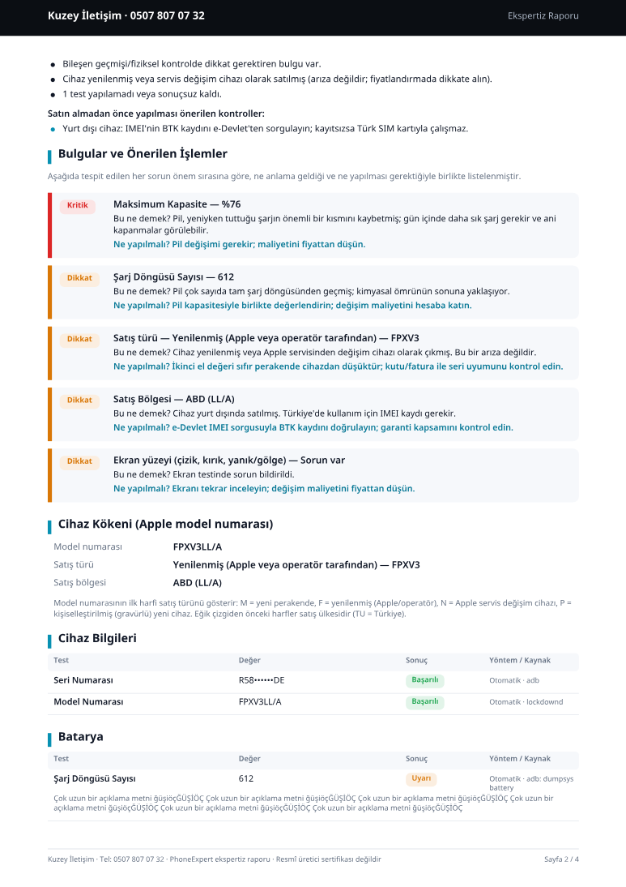
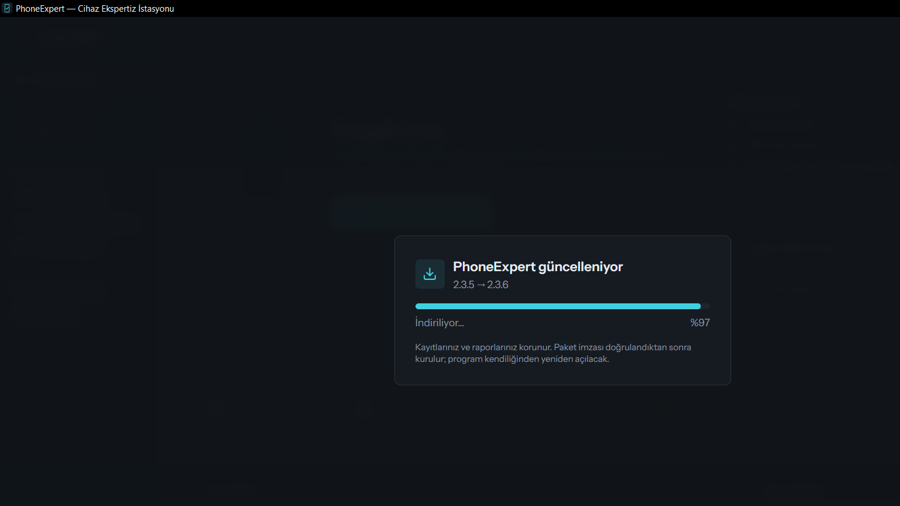

# PhoneExpert — Kurulum ve Güncellemeler

**iPhone ve Android telefon ekspertiz istasyonu** · *Kuzey İletişim · 0507 807 07 32*

## İndir
**[En son sürümü indir →](https://github.com/beytoaytkn35-stack/PhoneExpert-Releases/releases/latest)** — `PhoneExpert_Setup_x.y.z.exe` dosyasını çalıştırın. Kurulumdan sonra program her açılışta yeni sürümü kendiliğinden kurar.

## Neler yapar?
| Otomatik tarama | Etkileşimli testler | Sonuç ve öneri |
|---|---|---|
|  |  |  |

- Android ve iPhone'u USB ile bağlayıp pil, depolama, yazılım, güvenlik (root/FRP/MDM), donanım ve iPhone **satış türü/bölgesi** (yeni, yenilenmiş, servis değişim; Türkiye resmî mi) okur.
- Ekran, dokunmatik, kamera, ses ve sensörleri telefonun tarayıcısında **tam ekran sihirbazla** test eder.
- Piyasa mantığıyla satın alma önerisi ve fiyat pazarlığı notları üretir.
- Müşteriye verilebilir PDF raporu **Masaüstü › Sonuçlar** klasörüne kaydeder.

| Telefon test sayfası | Dokunmatik ızgara | PDF özet | PDF bulgular |
|---|---|---|---|
|  |  |  |  |

## Otomatik güncelleme

Güncellemeler dijital olarak imzalıdır; imzası doğrulanmayan paket kurulmaz. Kayıtlarınız ve raporlarınız güncellemede korunur.
